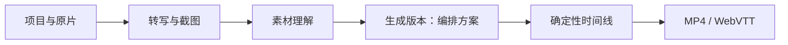

# 多项目与多版本视频编排工作台：AI 施工说明书

> 文档版本：v1.0  
> 面向对象：负责前端、Express API、SQLite 数据迁移、Worker 和测试的 AI 编码代理  
> 实施原则：先完成可用的“第二条视频 / 新版本”闭环，再迁移到完整的版本化模型；不要重写原有媒体分析、不可变原片、时间线和 Remotion 渲染能力。

## 1. 要解决的问题

当前界面是单项目长向导。项目完成后，素材和开始按钮被锁定，用户看不出应该：新建另一条视频、基于相同素材重新编排，还是查看此前成片。模型未启用时又会走本地确定性降级，页面仍使用“AI 理解”措辞，造成预期偏差。

本迭代将产品改为一个**多项目、可生成多个版本**的视频编排工作台。

### 1.1 用户可感知的目标

1. 已完成一条视频后，用户在一个明确操作内可以开始下一条。
2. 同一批素材可重复生成多个编排版本，旧成片永不被覆盖。
3. 每个生成版本都能看到：使用的模型、编排要求、步骤进度、编排结果、成片、字幕、失败信息和模型对话。
4. 未启用真实模型时，界面明确说明只能“按上传顺序合成”；不得声称已经理解素材内容。
5. 用户在网页中完成模型连接配置，不暴露或回传 API Key。

### 1.2 不变量（不得破坏）

- 原始视频一经保存不可覆盖、裁剪、转码、调色、降噪、变速或改写音轨。
- 每个有效素材在一个有效编排中恰好完整播放一次；程序而非模型计算帧时间线。
- 模型仅能根据规范化转写、截图结构化分析和媒体元数据提出顺序；不能得到媒体文件路径、原始音频、完整视频或渲染代码。
- 成片 MP4、VTT、原始媒体和模型日志均按租户与所有者隔离。
- API Key 只在服务端加密保存；模型对话日志不得写入 Key、图片/视频 base64 或完整媒体字节。

## 2. 产品术语（必须统一）

不要在面向用户的页面中使用“Relay”“中转站”等内部术语。

| 用户词汇 | 内部实现词汇 | 含义 |
| --- | --- | --- |
| 模型连接 | `RelayKey` / `RelayClient` | 程序到兼容 Responses API 的连接配置 |
| 视频项目 | `AutoVideoProject` | 一组不可变素材及其共同要求 |
| 生成版本 | `AutoVideoGeneration` | 一次独立分析、编排、渲染尝试 |
| 处理任务 | Worker job / step | 生成版本中的异步执行单元 |
| 本地顺序合成 | local deterministic mode | 不理解内容，仅按规则输出的显式兜底功能 |

### 2.1 唯一业务链路

系统仍只有一条业务链路：



模型连接只是 C、D 等阶段访问模型服务的基础设施，不是第二条剪辑链路。

## 3. 目标信息架构

### 3.1 工作台布局

桌面端采用固定项目导航 + 当前项目工作区；移动端将项目导航变为抽屉。

```text
┌──────────────────────────────────────────────────────────────────┐
│ 编排台       [ + 新建视频 ]   [ 模型设置 ] [ 模型对话 ]          │
├──────────────┬───────────────────────────────────────────────────┤
│ 我的项目     │ 项目名称 / 当前状态 / 最近更新时间                 │
│ • 夏日 vlog  │ [素材] [编排要求] [生成版本] [输出]               │
│ • 产品开箱   │                                                   │
│ • 新品广告   │ 当前版本：V3 处理中                               │
│              │ 步骤、模型状态、编排结果、预览和操作              │
└──────────────┴───────────────────────────────────────────────────┘
```

### 3.2 必须存在的主操作

| 场景 | 主按钮 | 行为 |
| --- | --- | --- |
| 任意页面 | `+ 新建视频` | 新建空项目，不影响当前项目 |
| 草稿项目 | `开始智能编排` | 创建一个新的生成版本并入队 |
| 已完成版本 | `基于此重新编排` | 使用同一素材和可编辑要求创建新版本 |
| 已完成版本 | `新建一条视频` | 创建新项目 |
| 失败版本 | `从失败步骤重试` | 只重试当前版本的失败步骤 |

完成页不得只显示禁用的“成片已完成”。必须同时显示“新建一条视频”“基于此重新编排”“下载成片”。

## 4. 状态模型

### 4.1 项目状态

项目只表示素材集合和用户意图，不应因为某次生成完成而永久锁死。

```ts
type ProjectStatus = 'draft' | 'ready' | 'archived';
```

- `draft`：可以添加、移除素材和编辑要求。
- `ready`：至少有一个可用素材；可以创建生成版本。
- `archived`：只读，不再允许新建版本。

### 4.2 生成版本状态

```ts
type GenerationStatus =
  | 'queued'
  | 'analyzing'
  | 'planning'
  | 'rendering'
  | 'completed'
  | 'failed'
  | 'cancelled';
```

一个项目可同时保留多个终态版本；默认只允许一个非终态版本，避免同一组素材重复抢占本地 Worker。若未来需要并发，改为按租户限流，不改变版本模型。

### 4.3 模型模式状态

```ts
type AiMode =
  | {kind: 'connected'; connectionId: string; model: string}
  | {kind: 'local'; reason: 'no_model_connection' | 'user_selected_local'}
  | {kind: 'blocked'; reason: 'connection_test_failed' | 'transcription_unavailable'};
```

规则：

- `connected`：允许“开始智能编排”。
- `local`：只允许按钮“按上传顺序合成”；点击前二次确认，说明不会理解画面、语音或叙事。
- `blocked`：显示“前往模型设置”或明确故障原因，禁止开始智能编排。

## 5. 数据模型与迁移

### 5.1 保留的现有实体

- `auto_video_projects`：项目、素材集合、所有者、画布和用户要求。
- `auto_video_assets`：原始不可变媒体与 ffprobe 元数据。
- `model_conversations`：模型请求、回复与失败审计。

### 5.2 新增 `auto_video_generations`

SQLite 表建议字段：

```sql
CREATE TABLE auto_video_generations (
  generation_id TEXT PRIMARY KEY,
  project_id TEXT NOT NULL,
  tenant_id TEXT NOT NULL,
  owner_id TEXT NOT NULL,
  version_number INTEGER NOT NULL,
  status TEXT NOT NULL,
  ai_mode_json TEXT NOT NULL,
  connection_id TEXT,
  model TEXT,
  instruction_snapshot TEXT NOT NULL,
  asset_ids_json TEXT NOT NULL,
  steps_json TEXT NOT NULL,
  transcripts_json TEXT NOT NULL,
  screenshot_analyses_json TEXT NOT NULL,
  asset_analyses_json TEXT NOT NULL,
  edit_plan_json TEXT,
  timeline_json TEXT,
  output_json TEXT,
  error_code TEXT,
  error_message TEXT,
  created_at TEXT NOT NULL,
  started_at TEXT,
  completed_at TEXT,
  updated_at TEXT NOT NULL,
  UNIQUE(project_id, version_number)
);

CREATE INDEX idx_generations_scope
  ON auto_video_generations(tenant_id, owner_id, project_id, updated_at DESC);
```

说明：

- 生成版本必须保存 `instruction_snapshot`、`asset_ids_json`、模型连接 ID 和模型名，而不是在执行途中读取可变项目字段。
- 版本的分析、计划、时间线和输出都与生成版本绑定；项目层只保存素材与当前草稿要求。
- 输出目录改为 `data/auto-video/projects/<projectId>/generations/<generationId>/`，旧版输出不得覆盖。

### 5.3 历史数据迁移

1. 对每一个旧 `AutoVideoProject` 创建版本号为 1 的 generation。
2. 将旧项目的 steps、analysis、edit plan、timeline 和 output 移入该 generation。
3. 保留旧项目 ID、原始媒体路径、签名下载规则和审计记录。
4. 在迁移完成前，读接口必须兼容旧数据；迁移失败要可重跑且幂等。
5. 禁止删除旧 MP4、VTT、素材或项目记录。

## 6. API 设计

保持现有身份头与租户校验。所有写操作都要求 producer/admin 角色；每次查询都按 tenant、owner 和角色过滤。

### 6.1 项目 API

| 方法 | 路径 | 说明 |
| --- | --- | --- |
| POST | `/api/projects` | 创建草稿项目 |
| GET | `/api/projects` | 列出项目摘要，包含 latestGeneration 摘要 |
| GET | `/api/projects/:projectId` | 项目、素材及版本摘要 |
| PATCH | `/api/projects/:projectId` | 在没有运行中版本时修改名称、要求或草稿元数据 |
| POST | `/api/projects/:projectId/archive` | 归档项目，不删除数据 |

### 6.2 版本 API

| 方法 | 路径 | 说明 |
| --- | --- | --- |
| POST | `/api/projects/:projectId/generations` | 根据项目快照创建版本；入参可覆盖本次编排要求和模型模式 |
| GET | `/api/projects/:projectId/generations` | 版本列表，倒序 |
| GET | `/api/projects/:projectId/generations/:generationId` | 版本详情、步骤与签名产物链接 |
| POST | `/api/projects/:projectId/generations/:generationId/retry` | 重试失败版本 |
| POST | `/api/projects/:projectId/generations/:generationId/cancel` | 取消可取消的任务 |
| GET | `/api/projects/:projectId/generations/:generationId/progress` | 轮询进度 |
| GET | `/api/projects/:projectId/generations/:generationId/output` | MP4/VTT 下载链接 |

### 6.3 模型连接 API

保留现有 `/api/keys` 实现，但将用户界面名称改为“模型连接”。新增只读状态接口：

```text
GET /api/model-connection/status
=> { mode, activeConnection?, transcriptionAvailable, message }
```

创建 generation 时由服务端写入当时的连接快照。不得让浏览器提交明文 Key 到任何非本机服务；Key 仅通过 HTTPS 发送给本服务，服务端加密持久化。

### 6.4 模型对话 API

现有模型对话查询增加 `generationId` 过滤，并在记录中保存 `generationId`。版本详情页应显示“本版本模型对话”入口。

## 7. Worker 实施要求

### 7.1 输入快照

Worker 只接收 `generationId`，启动后读取 generation 快照；不得读取可能被用户修改的项目要求作为运行时输入。

### 7.2 调用上下文

每一个模型调用必须写入：

```ts
{
  tenantId,
  ownerId,
  projectId,
  generationId,
  assetId?,
  source, // screenshot-analysis | asset-understanding | edit-planning
}
```

请求成功、失败、重试和结构化输出校验失败都必须留在同一版本审计链中。

### 7.3 本地模式

本地模式不能复用“智能编排”步骤名称和文案。它的输出必须显式写入：

```ts
{
  kind: 'local',
  reason: 'no_model_connection',
  summary: '未调用模型；已按上传顺序完整合成。'
}
```

默认情况下，未连接模型时禁止创建 `ai` generation；只有用户显式选择本地合成，才创建 `local` generation。

### 7.4 幂等与恢复

- 创建 generation 使用客户端幂等键；重复提交必须返回同一 generation。
- Worker 恢复时只扫描非终态 generation。
- 对已完成版本只允许下载、复制或基于其创建新版本；禁止覆盖其输出。
- 一个版本的失败重试不影响同项目的其他已完成版本。

## 8. 前端实施任务

### 阶段 A：第二条视频的最小闭环

1. 顶部固定、醒目的 `+ 新建视频` 主按钮。
2. 成品预览区新增：`新建一条视频`、`基于此重新编排`、`下载 MP4`。
3. 项目历史由卡片列表升级为可见项目导航，显示状态、版本数和最近更新时间。
4. 模型状态卡显示“已连接模型 / 未连接模型 / 连接异常”。
5. 未连接模型时，将现有按钮改成 `按上传顺序合成`，并显示确认说明；不得显示“AI 编排结果”。

### 阶段 B：版本界面

1. 当前项目页增加版本列表：`V1`、`V2`、状态、模型、时间、耗时。
2. 点击一个版本后显示独立的步骤、计划、分析、对话和输出。
3. “重新编排”弹窗可修改本次要求、选择模型连接，并显示会生成新版本、不会覆盖旧版本。
4. 输出预览组件按 generation URL 获取 MP4/VTT。

### 阶段 C：模型连接体验

1. 将“中转站 Key 管理”文案全部替换成“模型连接”。
2. 保持 API Key 密码输入、掩码显示、服务端加密存储和连接测试。
3. 保存并设为当前后，刷新模型状态卡；不自动调用模型。
4. 文案说明：模型连接仅为编排链路提供理解和排序能力，不是第二条业务链路。

### 前端性能约束

- 项目列表、版本历史和模型对话均应按需加载或分页；大量记录不得一次渲染。
- `KeyManager`、模型对话详情和版本对比面板使用 React lazy + Suspense 按需加载。
- 状态轮询只发生在当前可见、非终态 generation 上；页面失焦或组件卸载后取消轮询。
- 用户输入的项目要求不能因轮询而被覆盖。

## 9. 后端实施任务

1. 在 shared contracts 中新增 generation schema、枚举、请求/响应 schema。
2. 为 SQLite Store 增加 generation CRUD、查询范围校验、幂等记录和迁移方法。
3. 将 AutoVideoWorker 的队列键从 `projectId` 改为 `generationId`。
4. 将分析结果、计划、时间线、输出路径从项目层迁移到 generation 层。
5. 更新签名下载路由，允许按 generation 读取产物并验证项目归属。
6. 为模型对话记录添加 generationId，并提供筛选 API。
7. 增加模型连接状态 API；不要向客户端返回 API Key。
8. 保留旧项目 API 一段兼容期，或同步升级前端后一次性切换；不得出现一半页面读旧项目、一半页面读新版本的混合状态。

## 10. 验收用例

### 10.1 主流程

1. 用户完成项目 A 的 V1 后，在完成页点击“新建一条视频”。
2. 创建项目 B、上传素材并生成。
3. 项目 A 的 MP4/VTT 与 V1 详情仍可下载，项目 B 独立存在。

### 10.2 同素材新版本

1. 用户打开项目 A 的 V1，点击“基于此重新编排”。
2. 修改编排要求并创建 V2。
3. V2 进行完整独立处理；V1 的时间线、输出和模型对话不发生改变。
4. V1、V2 均可在版本列表中切换和下载。

### 10.3 模型状态真实表达

1. 无当前模型连接时，智能编排按钮不可用，并给出“前往模型设置”。
2. 用户选择“按上传顺序合成”后，输出版本标明 local mode，且不产生伪造模型对话。
3. 设置并启用模型连接后，新创建的 AI version 记录实际模型、模型调用和模型对话。
4. 连接失败时版本失败在对应步骤，包含可读错误和重试入口。

### 10.4 安全与隔离

1. 租户 A 不能读取、下载、重试或查看租户 B 的项目、版本、素材、输出或模型对话。
2. API 响应、SQLite 的模型对话 payload 和浏览器 DOM 不含 API Key 或媒体 base64。
3. 删除/归档项目不立即破坏已在运行的任务；实现明确的取消和回收策略。

### 10.5 回归检查

- 原片哈希与路径始终不变。
- 每个有效素材在一条 generation 的时间线中恰好一次、无空洞、无重叠。
- 失败任务重启服务后可从 generation 检查点恢复。
- `pnpm test`、`pnpm build` 均通过。
- 桌面和移动端检查：新建视频入口、项目切换、版本切换、完成页三主操作、模型设置和模型对话。

## 11. 非目标

以下内容不属于本迭代，除非单独立项：

- 手工拖拽时间线或人工排序；
- 裁剪、转码、调色、降噪、变速或覆盖原片；
- 在一次生成中省略或重复有效素材；
- 多人协作、评论、审批流；
- 自动根据成本切换模型供应商；
- 将 API Key 保存到浏览器本地存储；
- 为兼容旧代码而继续在用户界面暴露“Relay”术语。

## 12. 推荐施工顺序

1. 先完成阶段 A 的页面出口和模型状态真相化，解决“第二条视频做不了”与“本地模式伪装 AI”的核心体验问题。
2. 再完成 generation 表、Store、Worker 迁移和历史数据迁移。
3. 接入版本 API 和版本工作台。
4. 将模型对话关联到 generation，并做端到端真实模型冒烟测试。
5. 最后清理旧项目层的输出/分析字段和兼容代码；此步骤必须在迁移验证完成后执行。

每一步必须保持：构建通过、单元测试通过、一个历史项目可读、一个新项目可生成。禁止为了加快迁移而删除用户已有项目或产物。
