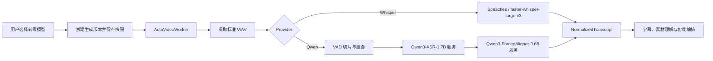

# Qwen3-ASR-1.7B 可切换语音转写：AI 实施计划

> Document version: v1.0
> Created: 2026-08-19
> Status: application and local gateway implementation complete; forced-alignment E2E, the TypeScript HTTP Provider path, and a 17-clip real car-wash A/B run were verified on 2026-08-20; human ground-truth scoring and a complete Qwen generation/export acceptance run remain pending
> Audience: TypeScript, Express, SQLite, audio-transcription service, React UI, caption-timestamp, and test engineers
> Related implementation: `src/server/speaches.ts`, `src/server/auto-video-worker.ts`, `src/server/index.ts`, `src/shared/auto-video-contracts.ts`, `src/client/AutoVideoApp.tsx`

## 1. 目标、用户价值与范围

### 1.1 目标

为“洗车片场”自动视频编排增加 **Qwen3-ASR-1.7B** 语音转写能力，并在创建智能编排版本时提供用户可见、可选择的转写模型按钮。现有 `Systran/faster-whisper-large-v3` 保留为默认模型和兼容路径。

面向洗车营销短视频，重点改善以下转写问题：

- 水枪、泡沫机、吸尘器、环境音乐等干扰下的漏字或吞字；
- 快速口播、口语化表达、地方口音和中文方言；
- 门店名、套餐名、优惠信息与洗车专业词的识别；
- 可直接用于字幕和视频理解的、带可靠时间范围的转写结果。

### 1.2 MVP 范围

1. 创建“智能编排”生成版本时，提供两项互斥的转写模型按钮：
   - **Whisper large-v3（默认）**
   - **Qwen3-ASR-1.7B（中文增强）**
2. Qwen 选项仅在 Qwen ASR 与 Qwen 强制对齐服务均健康可用时可点击；不可用时明确显示原因，不能伪装为可用。
3. Qwen 模式执行：音频预处理 → VAD 切片 → Qwen3-ASR-1.7B 转写 → Qwen3-ForcedAligner-0.6B 对齐 → 统一字幕时间戳输出。
4. 每个生成版本持久化所选转写提供方、模型、服务版本和配置快照；重试、恢复和导出必须继续使用该快照。
5. Whisper 既有生成版本、接口与字幕流程保持可用。
6. 增加真实洗车素材 A/B 评测，基于漏字、专业词、字幕对齐和耗时决定是否把 Qwen 改为默认。

### 1.3 非目标

- 不删除或静默替换当前 Speaches / faster-whisper 服务。
- 不允许网页前端传入任意 ASR URL、模型名、API Key 或 Prompt；服务地址、凭据和允许模型仅由服务端环境变量控制。
- 不在运行中的生成版本中切换模型，也不将一个素材的部分片段用 Whisper、部分片段用 Qwen 后静默拼接。
- 不在本次把 Qwen 用作画面理解、文案生成或视频编排模型；它仅负责音频转写和时间对齐。
- 不承诺未通过真实洗车素材验证的准确率提升。

## 2. 当前现状与关键差距

当前链路是：`extractAnalysisAudio()` 将原视频提取为单声道、16 kHz、PCM WAV；`SpeachesTranscriptionProvider` 将整段音频发送到 OpenAI 兼容的 `/audio/transcriptions`；返回结果被标准化为 `NormalizedTranscript`，供字幕、素材理解和编排使用。

当前默认模型为：

```env
SPEACHES_MODEL=Systran/faster-whisper-large-v3
```

现有合同将 `NormalizedTranscript.provider` 固定为 `speaches`，且模型状态接口只暴露一个全局转写服务。因此不能只把环境变量改成 `Qwen/Qwen3-ASR-1.7B`：本机 Speaches 服务不会自动加载 Qwen 模型，也无法保证返回 Qwen 所需的词/片段时间戳。

Qwen 接入必须作为独立 Provider 实现，并使用强制对齐服务生成字幕所需的时间戳；不能以“只返回整段文字”的方式替换现有链路。

## 3. 产品与界面合同

### 3.1 按钮位置与交互

在“创建智能编排版本”的设置区、现有画面理解并发选项附近新增 **“语音转写模型”** 字段，使用分段按钮，不使用隐藏的全局开关。

```text
语音转写模型
[ Whisper large-v3（默认） ]  [ Qwen3-ASR-1.7B（中文增强） ]

Whisper large-v3：当前稳定方案，已接入词级与片段级时间戳。
Qwen3-ASR-1.7B：适合中文口播、噪声与方言；将额外执行时间对齐，处理速度可能更慢。
```

规则：

| 情况 | 行为 |
| --- | --- |
| 新建生成版本 | 默认选中 Whisper；用户可改选 Qwen。 |
| Qwen 服务或对齐器不健康 | Qwen 按钮禁用，并显示服务端返回的原始 `code`、`message` 与可重试信息。 |
| 生成版本已提交 | 将所选模型显示为只读标签，例如 `转写：Qwen3-ASR-1.7B`。 |
| 运行、等待重试、已完成、已取消版本 | 不显示切换按钮，防止同一版本混用模型。 |
| 用户需要换模型重做 | 创建一个新的生成版本；原版本的素材和结果保留，便于对比。 |

### 3.2 不采用“全局即时切换”的原因

模型选择必须属于 **生成版本快照**，不是应用全局配置。一个项目可有多个版本：例如版本 A 用 Whisper，版本 B 用 Qwen；两者可在同一批原始素材上比较。这样能保证字幕、素材说明、编排结论和审计记录可追溯。

### 3.3 可用性接口

新增或替换为以下只读接口：

```ts
GET /api/transcription/providers
```

示例响应：

```ts
type TranscriptionProviderStatus = {
  id: 'speaches-whisper' | 'qwen3-asr';
  label: string;
  model: string;
  configured: boolean;
  reachable: boolean;
  ready: boolean;
  supportsWordTimestamps: boolean;
  supportsSegmentTimestamps: boolean;
  message: string;
  error?: {code: string; message: string; retryable: boolean};
};

type TranscriptionProviderStatusResponse = {
  defaultProviderId: 'speaches-whisper' | 'qwen3-asr';
  providers: TranscriptionProviderStatus[];
};
```

保留现有 `/api/transcription/status` 与 `/api/transcription/start` 至少一个兼容版本；其语义固定为 Whisper 默认服务，或返回明确的 `deprecated` 标记。不能让旧客户端误以为它能启动任意被用户选中的模型。

## 4. 数据合同与不变量

### 4.1 Provider 枚举

在 `src/shared/auto-video-contracts.ts` 定义唯一的、受限的 Provider ID：

```ts
export const transcriptionProviderIdSchema = z.enum([
  'speaches-whisper',
  'qwen3-asr',
]);
export type TranscriptionProviderId = z.infer<typeof transcriptionProviderIdSchema>;
```

将原先固定的：

```ts
provider: z.literal('speaches')
```

扩展为：

```ts
provider: transcriptionProviderIdSchema
```

`model` 继续保留模型的精确标识，如 `Systran/faster-whisper-large-v3` 或 `Qwen/Qwen3-ASR-1.7B`。

### 4.2 生成版本请求与快照

在 `autoVideoGenerationCreateSchema` 及持久化的生成版本选项中新增：

```ts
type TranscriptionSelection = {
  providerId: 'speaches-whisper' | 'qwen3-asr';
};
```

生成任务创建后，服务端将其解析、校验并固化为不可变快照：

```ts
type TranscriptionRunSnapshot = {
  providerId: 'speaches-whisper' | 'qwen3-asr';
  model: string;
  alignmentModel?: string;
  language: 'zh';
  vocabularyProfile: 'car-wash-zh-v1';
  audioProfile: 'mono-16khz-pcm-s16le-v1';
  chunkingProfile?: 'vad-overlap-30s-v1';
  providerServiceVersion?: string;
};
```

**不变量：**

1. 每个生成版本只有一个 `TranscriptionRunSnapshot`。
2. 同一生成版本中全部素材都由同一个 Provider 和模型处理。
3. 重试、恢复、从检查点继续必须使用保存的快照，不能读取后来改动的默认环境变量。
4. 原始转写服务响应仅保存为生成版本私有审计工件；不得写入 API Key、授权头、原始视频或音频二进制内容。
5. `NormalizedTranscript.assetId` 必须等于正在处理的素材 ID；全部 `word` / `segment` 时间范围必须在视频时长内，且满足 `startMs < endMs`。
6. 任何不能提供有效对齐时间戳的 Qwen 结果不得标为转写完成，也不得生成误导性字幕。

### 4.3 既有数据兼容

- 没有 `transcriptionSelection` 的旧生成版本按历史行为视为 `speaches-whisper`。
- 已保存的 `provider: 'speaches'` 在读取时迁移为 `speaches-whisper`；写回时统一使用新枚举。
- SQLite 迁移必须可重复执行。升级前的项目、版本、检查点与字幕文件不得被删除或重新识别。

## 5. 服务端工作流与工具边界



### 5.1 Provider Registry

将现有 `createTranscriptionProvider()` 改为 Provider Registry，而不是把 Qwen 逻辑塞进 `SpeachesTranscriptionProvider`：

```ts
interface TranscriptionProvider {
  readonly id: TranscriptionProviderId;
  status(): Promise<TranscriptionProviderStatus>;
  start?(): Promise<TranscriptionProviderStatus>;
  transcribe(input: TranscriptionInput, snapshot: TranscriptionRunSnapshot): Promise<TranscriptionResult>;
}

interface TranscriptionProviderRegistry {
  listStatuses(): Promise<TranscriptionProviderStatusResponse>;
  resolve(snapshot: TranscriptionRunSnapshot): TranscriptionProvider;
  createSnapshot(selection: TranscriptionSelection): Promise<TranscriptionRunSnapshot>;
}
```

职责边界：

- **Registry**：只接受受控 Provider ID，健康检查，创建版本快照，解析 Provider。
- **Speaches Provider**：保留现有 OpenAI 兼容调用及 `verbose_json` 标准化。
- **Qwen Provider**：只负责调用受控 Qwen 网关、接收文本与区间、执行强制对齐、标准化结果。
- **Worker**：根据版本快照调用 Provider；不关心 HTTP 协议或模型细节。
- **字幕模块**：继续只依赖 `NormalizedTranscript`，不引入模型分支。

### 5.2 Qwen 服务适配层

部署一个受服务端控制的 Qwen ASR 适配服务，推荐与主应用分离为独立容器/进程。适配层加载：

```text
Qwen/Qwen3-ASR-1.7B
Qwen/Qwen3-ForcedAligner-0.6B
```

适配层必须定义并测试稳定的内部合同；不要假定 Qwen 官方 Python SDK、Transformers 或 vLLM 的任一开发接口天然与现有 OpenAI 音频接口完全兼容。

建议内部 API：

```ts
POST /internal/asr/qwen3/transcribe
// multipart: audio, language, vocabularyProfile, requestId
// response: { text, detectedLanguage?, segments?: [...], serviceVersion }

POST /internal/asr/qwen3/align
// JSON 或 multipart: audio, transcript, language, requestId
// response: { words: [...], segments: [...], alignmentModel, serviceVersion }
```

接口错误必须直接透传：

```ts
{code: string; message: string; retryable: boolean; providerRequestId?: string}
```

不得把上游错误改写成 `QWEN_FAILED` 后丢失原始 `code` 与 `message`。附加阶段、素材 ID、请求 ID 或重试次数时，只能增加字段。

### 5.3 音频处理、VAD 与行业词

Qwen Provider 的首版处理流程：

1. 重用已有 `extractAnalysisAudio()`：单声道 16 kHz、WAV、PCM S16LE。
2. 使用服务端 VAD 将连续语音切成最长约 30 秒的片段。
3. 相邻片段保留约 400 ms 重叠，避免词尾/词首被切断。
4. 每个片段送入 Qwen3-ASR-1.7B；识别文本按时间顺序合并与去重。
5. 使用合并文本及原始音频调用 ForcedAligner，获取全局词级/片段级时间范围。
6. 对齐完成后才构造 `NormalizedTranscript`。

行业词表属于版本化服务端数据，例如 `car-wash-zh-v1`：

```text
精洗、普洗、内饰清洁、臭氧消毒、抛光、打蜡、镀膜、
发动机舱、轮毂、玻璃油膜、吸尘、泡沫、冲洗、团购、
会员卡、套餐、到店、活动价、优惠
```

词表用途是提示和评测，不得伪造音频中没有说出的文字。若 Qwen 服务接口不支持受控词表提示，适配层必须将该功能标为不支持，而不是静默忽略。

### 5.4 失败、重试和取消

| 场景 | 行为 |
| --- | --- |
| Qwen ASR 服务未配置/不可达 | 创建版本时禁用 Qwen；若状态在提交后变化，保存原始错误并进入既有可重试/人工处理流程。 |
| Qwen 返回文本但 ForcedAligner 失败 | 不写完成转写；保留 ASR 原始响应作为审计工件，按对齐阶段失败处理。 |
| VAD 无语音 | 输出合法空转写，标记原因；字幕为空，不凭空补字。 |
| 请求超时、429、5xx 或短暂网络错误 | 保留原始错误并按既有重试策略重试；同一版本继续使用 Qwen 快照。 |
| 401、403、合同校验失败、未知 Provider | 不重试，进入 `needs_attention` 或相应现有终态。 |
| 用户中断 | 终止正在执行的 VAD、Qwen 或对齐请求；不提交半成品 `NormalizedTranscript`。 |
| 用户选择 Qwen 后服务故障 | **MVP 不静默回退到 Whisper。**用户选择必须可追溯；需用户新建 Whisper 版本或以后显式启用“允许回退”策略。 |

## 6. 配置、部署与权限

新增环境变量示例：

```env
# 现有默认路径
SPEACHES_BASE_URL=http://127.0.0.1:8000/v1
SPEACHES_MODEL=Systran/faster-whisper-large-v3

# Qwen 可选路径。留空时，界面必须禁用 Qwen 按钮。
QWEN_ASR_BASE_URL=http://127.0.0.1:8010
QWEN_ASR_API_KEY=
QWEN_ASR_MODEL=Qwen/Qwen3-ASR-1.7B
QWEN_ALIGN_MODEL=Qwen/Qwen3-ForcedAligner-0.6B
QWEN_ASR_TIMEOUT_MS=600000
QWEN_ASR_MAX_RETRIES=2
QWEN_ASR_VOCABULARY_PROFILE=car-wash-zh-v1
```

部署要求：

- Qwen 服务只监听私有网络或 `127.0.0.1`，不直接暴露给浏览器。
- API Key 仅保存在服务端环境变量或密钥管理系统，不写入 SQLite、项目 JSON、模型对话日志、浏览器接口或前端 bundle。
- 上传音频必须继续沿用项目/租户授权；适配服务只接受主应用签发的短期内部鉴权或受限服务凭据。
- 在目标 GPU/CPU 环境上先测量模型加载耗时、并发、显存/内存、每分钟音频耗时与超时行为，再设定 `AUTO_VIDEO_ASSET_CONCURRENCY`。不以推测值设定生产并发。
- 服务启动时应分别健康检查 ASR 与对齐模型；任何一个未就绪，Qwen Provider 均为 `ready: false`。

## 7. 计划改动清单

| 层 | 文件 | 计划修改 |
| --- | --- | --- |
| 共享合同 | `src/shared/auto-video-contracts.ts` | Provider 枚举、创建请求的选择字段、版本快照、`NormalizedTranscript` 兼容迁移。 |
| ASR Provider | `src/server/speaches.ts` | 将当前 Speaches 实现保留为 Whisper Provider；抽取通用接口和 Registry。 |
| 新 Provider | `src/server/qwen3-asr.ts` | Qwen 服务健康检查、转写、VAD/合并、ForcedAligner、结果标准化和原始响应审计。 |
| 配置 | `.env.example`、`docker-compose.yml` | Qwen 服务变量、仅可选启用的配置说明。 |
| 工作器 | `src/server/auto-video-worker.ts` | 从版本快照解析 Provider；将 ASR/对齐阶段纳入取消、重试、检查点和原始工件记录。 |
| HTTP API | `src/server/index.ts` | Provider 列表状态接口、创建生成版本时校验选择、旧状态接口兼容。 |
| 客户端类型/API | `src/client/auto-video-api.ts` | Provider 状态与创建版本的模型选择类型及请求。 |
| 客户端界面 | `src/client/AutoVideoApp.tsx`、`src/client/styles.css` | 模型分段按钮、状态说明、禁用原因、版本只读标签。 |
| 测试 | `src/server/auto-video.test.ts`、新增 `src/server/qwen3-asr.test.ts`、必要客户端测试 | 合同、路径、错误、时间戳、回归和 UI 测试。 |
| 文档 | `README.md`、`washcut-agent-demo/README.md`、本文件 | 部署、使用、模型选择和修改日志。 |

## 8. 分阶段实施步骤

### 阶段 0：基线与样本集（先做）

1. 从真实洗车素材中挑选 20–50 段片段，覆盖清晰普通话、快速口播、水枪/吸尘器噪声、背景音乐、至少一种地方口音、门店/套餐/优惠专业词。
2. 为每段制作人工校对的参考文本和重点词清单；保留原始素材 ID，不把音频复制到代码仓库。
3. 用现有 Whisper large-v3 跑出基线：字符错误率、删除错误率（漏字）、专业词准确率、字幕对齐偏差、每分钟处理耗时和失败率。
4. 定义验收门槛后再实现默认值切换；初版不改变默认模型。

### 阶段 1：先做合同与兼容迁移

1. 增加受限 Provider ID、选择字段和版本快照 Schema。
2. 实现旧 `provider: 'speaches'` 的读时迁移及新写入格式。
3. 在创建生成版本时由服务端验证选择项；拒绝未注册、未就绪或用户伪造的 Provider ID。
4. 编写 Schema、SQLite 迁移、旧版本读取和快照不可变测试。

### 阶段 2：抽取 Registry，保持 Whisper 不变

1. 将当前 `SpeachesTranscriptionProvider` 明确命名为 `speaches-whisper` Provider。
2. 将 `AutoVideoWorker` 的单例 Provider 依赖替换为 Registry + 版本快照解析。
3. 确保全部现有 Whisper 测试通过，输出字幕不变。
4. 在该阶段结束时，UI 仍可只显示 Whisper；不得提前展示尚未可用的 Qwen 按钮。

### 阶段 3：实现 Qwen 服务适配与时间对齐

1. 确认拟部署的 Qwen3-ASR-1.7B 与 ForcedAligner 版本、运行后端和内部 HTTP 合同；将请求/响应 fixture 固化为测试数据。
2. 实现 Qwen 服务健康检查，分别验证 ASR 和对齐器可用。
3. 实现 VAD 切片、重叠、顺序合并、重复文本处理及上下文保留策略。
4. 实现识别后强制对齐，并将对齐输出转换为现有 `TranscriptWord` 与 `TranscriptSegment`。
5. 对所有模型输出执行 Zod 校验、素材 ID 校验、时长边界校验、非递减排序检查和空文本规则。
6. 保存原始 Qwen ASR/对齐响应，但保证响应中不包含凭据或音频二进制。

### 阶段 4：接入界面按钮和状态反馈

1. 前端加载 Provider 列表与可用性。
2. 默认选择 Whisper，并渲染两个互斥按钮。
3. Qwen 未就绪时禁用按钮并显示可操作原因；服务端仍负责最终校验，不能只依赖前端。
4. 创建版本请求携带 `transcriptionSelection.providerId`。
5. 生成版本详情显示锁定模型、模型版本、是否启用对齐，以及失败阶段。
6. 以键盘、屏幕阅读器和窄屏布局验证按钮可用性，不仅验证鼠标点击。

### 阶段 5：评测、灰度与默认值决策

1. 对阶段 0 的固定样本跑 Whisper 和 Qwen；人工复核差异。
2. 仅当 Qwen 在漏字率、专业词准确率和字幕可用性上达到已定义门槛，并且延迟/资源在目标机器预算内，才考虑在新安装中把默认值改为 Qwen。
3. 先保持生产默认 Whisper，并允许受控用户手动选择 Qwen；收集失败码、耗时和人工修正量。
4. 评测不达标时保留 Qwen 为试验选项或下线按钮，不修改历史生成版本。

## 9. 测试与验收

### 9.1 自动化测试

至少覆盖：

- Provider ID、创建请求和快照 Schema 的合法/非法值；
- 旧 `speaches` 转写记录读入后的兼容性；
- Qwen 未配置、ASR 不可达、Aligner 不可达、模型未就绪时的状态；
- 前端不能选择未就绪 Qwen，服务端也拒绝伪造请求；
- Qwen 成功路径输出的词/片段时间范围符合 `NormalizedTranscript`；
- VAD 切片边界的词不重复、不丢失，合并后顺序稳定；
- ASR 成功但对齐失败时不产生“completed”字幕；
- 重试、服务重启恢复和用户中断后仍使用同一个 Qwen 快照；
- 用户选 Qwen 时不发生静默 Whisper 回退；
- 现有 Whisper 生成、字幕、编排和导出回归测试；
- 多租户授权、凭据不泄露、原始错误 `code` / `message` / `retryable` 透传。

### 9.2 人工验收样例

| 编号 | 输入 | 期望结果 |
| --- | --- | --- |
| A1 | 清晰中文洗车口播 | 可选择 Qwen；字幕文本完整，词/片段时间有效。 |
| A2 | 水枪和吸尘器背景下的套餐口播 | Qwen 结果可与 Whisper 直接对比；不宣称结果必然更好，人工记录漏字和重点词。 |
| A3 | Qwen 服务未启动 | Qwen 按钮禁用，页面展示真实不可达原因；Whisper 仍可创建版本。 |
| A4 | Qwen 对齐服务故障 | 版本显示对齐阶段原始错误；不导出伪造时间戳字幕。 |
| A5 | 用 Qwen 创建后点击重试/恢复 | 继续使用 Qwen 快照而非新的默认配置。 |
| A6 | 已完成的 Whisper 旧版本 | 仍能查看、重试历史允许的阶段并导出，不被迁移破坏。 |

### 9.3 完成定义

只有同时满足下列条件，才可标记此计划为已实施：

1. 界面提供可访问的 Whisper/Qwen 两按钮选择，并且 Qwen 只在双服务就绪时可选。
2. 新生成版本、检查点、原始工件和详情都可追溯到唯一的转写快照。
3. Qwen 输出经过强制对齐并通过既有字幕合同校验；不使用伪造或估算的时间戳。
4. 现有 Whisper 工作流与旧数据兼容测试通过。
5. Qwen 的错误、取消与重试经过自动化测试，且没有静默降级。
6. 至少完成一轮真实洗车素材 A/B 评测并记录结果；默认模型是否调整由结果决定。
7. 完成 TypeScript 校验、服务端测试、生产构建和至少一次包含 Qwen 的真实项目级字幕/成片人工验证。

## 10. 风险、决策与待确认项

| 风险/问题 | 决策或处理 |
| --- | --- |
| Qwen 的运行服务 API 与现有 Speaches 不同 | 采用独立内部适配层，先固定并测试 HTTP 合同，主应用不直接依赖某个 Python 开发 API。 |
| Qwen 转写有文本但没有可靠字幕时间戳 | 强制对齐是完成条件；对齐失败即失败，不生成伪时间戳。 |
| GPU/内存不足导致队列阻塞 | 上线前实测后设置并发；Qwen 先作为可选按钮，不立刻替换默认模型。 |
| 新模型的准确率宣传不等于实际门店素材表现 | 用固定的真实洗车样本 A/B 决策，不基于模型名称或厂商材料直接切换默认。 |
| 用户误以为随时可以改模型修复同一版本 | 界面明确显示“模型在创建版本时锁定；换模型请新建版本”。 |
| Provider 自动回退会掩盖识别来源 | MVP 不静默回退；以后如确有需要，设计成用户明确可见且记录在快照内的单独策略。 |

## 11. 外部模型资料（实施前复核）

实施人员需要在开始部署前复核官方文档、模型许可证、硬件要求和选定服务端版本。建议以以下官方资料为准：

- Qwen3-ASR：<https://github.com/QwenLM/Qwen3-ASR>
- Qwen3-ASR-1.7B 模型卡：<https://huggingface.co/Qwen/Qwen3-ASR-1.7B>
- Qwen3 ForcedAligner：<https://huggingface.co/Qwen/Qwen3-ForcedAligner-0.6B>
- 现有 faster-whisper：<https://github.com/SYSTRAN/faster-whisper>

本文是实施规格，不表示 Qwen 服务已部署、模型已下载、GPU 资源已验证或准确率评测已完成。
